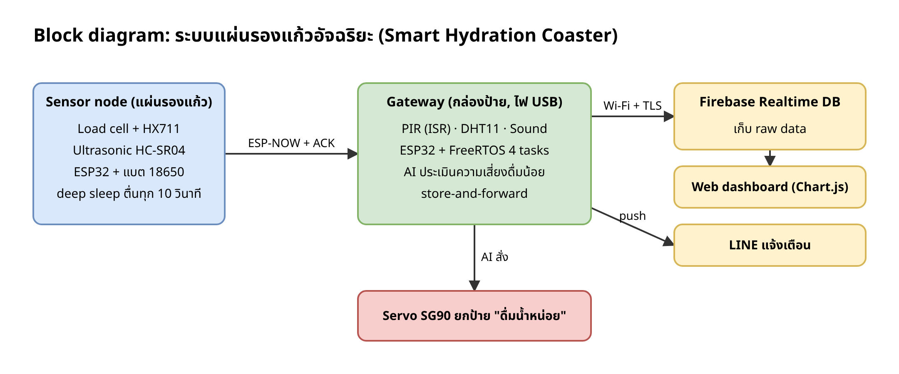

# Smart Coaster 💧

แผ่นรองแก้วเตือนดื่มน้ำ · CEDT Embedded System Final Project 2026

แผ่นรองแก้ว (**node**) ชั่งน้ำหนักแก้วและวัดระยะ แล้วส่งให้กล่องป้าย (**gateway**) ผ่าน ESP-NOW
gateway อ่านสภาพห้อง (อุณหภูมิ/ความชื้น, เสียง, คนเดินผ่าน) ตรวจจับการดื่ม ให้ AI ประเมินความเสี่ยงว่าจะดื่มน้อย
แล้วสั่งเซอร์โวยกป้ายเตือน + ส่ง LINE และส่งข้อมูลทั้งหมดขึ้น Firebase

- การดื่ม / AI / LINE / โหมดเร่งเวลาถ่ายวิดีโอ: [docs/ai-and-drinks.md](docs/ai-and-drinks.md)
- E5 ความปลอดภัย (ต้องตั้งค่า Firebase เอง): [docs/security-e5.md](docs/security-e5.md)



## ฮาร์ดแวร์

| บอร์ด | อุปกรณ์ | ขา (ESP32 DevKit V1 30 ขา) |
|---|---|---|
| **Node** (แผ่นรองแก้ว) | Load cell + HX711 | DT=GPIO19, SCK=GPIO18 |
| | Ultrasonic HC-SR04 | Trig=GPIO25, Echo=GPIO26 (ผ่านตัวแบ่ง 1k/2k) |
| **Gateway** (กล่องป้าย) | DHT11 (KY-015) | S=GPIO14 |
| | PIR HC-SR501 | OUT=GPIO27 |
| | เสียง KY-038 | AO=GPIO35, DO=GPIO32 |
| | Servo SG90 | สัญญาณ=GPIO18 |
| | ปุ่มหยุดฉุกเฉิน | GPIO33 ↔ GND |

ตารางขาเต็ม: [docs/wiring/pin-table.md](docs/wiring/pin-table.md) · รูปวงจร: [node](docs/wiring/wiring-node.png), [gateway](docs/wiring/wiring-gateway.png)

วงจรสำหรับเทสทีละตัว (บอร์ดเปล่า + เซนเซอร์ 1 ตัว, ไฟจาก USB): [t01](docs/wiring/tests/t01-blink.png) · [t02 DHT11](docs/wiring/tests/t02-dht11.png) · [t03 PIR](docs/wiring/tests/t03-pir.png) · [t04 เสียง](docs/wiring/tests/t04-sound.png) · [t05 servo + ปุ่ม](docs/wiring/tests/t05-servo.png) · [t06 HC-SR04](docs/wiring/tests/t06-ultrasonic.png) · [t07/t08 HX711](docs/wiring/tests/t07-t08-hx711.png)

> ⚠️ ทั้งสองบอร์ดใช้ GPIO18 (node = HX711 SCK, gateway = เซอร์โว) ติดป้ายบอร์ดว่า NODE / GATEWAY ไว้ จะได้ไม่อัปโหลดผิดตัว

## โครงสร้าง repo

```
├── tests/              sketch ทดสอบเซนเซอร์ทีละตัว (ทำก่อน)
│   ├── t01_blink/          ทั้ง 2 บอร์ด: LED กะพริบ + พิมพ์ MAC
│   ├── t02_dht11/          gateway
│   ├── t03_pir/            gateway (interrupt)
│   ├── t04_sound/          gateway
│   ├── t05_servo/          gateway (เซอร์โว + ปุ่มหยุด)
│   ├── t06_ultrasonic/     node
│   ├── t07_hx711_cal/      node: หา CAL_FACTOR
│   ├── t08_hx711_weigh/    node: ชั่งจริง
│   ├── t10_line/           gateway: ทดสอบ LINE broadcast
│   └── t12_tls/            gateway: ทดสอบตรวจ certificate (E5)
├── ai/                 train.py เทรนโมเดล AI → gateway/ai_model.h
├── common/             รูปแบบข้อความ ESP-NOW และ LINE helper (ต้นฉบับ)
├── node/               firmware node (อ่านน้ำหนัก+ระยะ → ESP-NOW)
├── gateway/            firmware gateway: FreeRTOS tasks, ตรวจการดื่ม, AI, servo, LINE, Firebase
├── dashboard/          หน้าเว็บ Chart.js อ่านจาก Firebase
├── firebase/           database rules (test mode / แบบล็อกอิน)
└── docs/               รูปวงจร, ตารางขา, calibration log
```

## เริ่มต้น

### 1. เครื่องมือ
- Arduino IDE 2.x + บอร์ด **esp32 by Espressif Systems เวอร์ชัน 3.x**
  (Boards manager URL: `https://espressif.github.io/arduino-esp32/package_esp32_index.json`)
- เลือกบอร์ด **DOIT ESP32 DEVKIT V1**
- ไลบรารี: **DHT sensor library** (Adafruit), **HX711** (bogde), **ArduinoJson** v7

#### ใช้ VS Code + PlatformIO แทน Arduino IDE

1. ติดตั้งส่วนขยาย **PlatformIO IDE** ใน VS Code แล้วเปิดโฟลเดอร์รากของ repo นี้
2. เปิด PlatformIO Home หรือใช้แถบ PlatformIO ให้ส่วนขยายติดตั้ง PlatformIO Core
   และเครื่องมือ ESP32 ที่จำเป็น
3. เลือก environment จาก `platformio.ini` แล้วกด **Build** หรือใช้คำสั่ง
   `pio run -e <environment>`:
   - `t03_pir` เป็นค่าเริ่มต้น (ทดสอบ PIR)
   - `node`, `gateway` สำหรับ firmware หลัก
   - `t01_blink`, `t02_dht11`, `t03_pir`, `t04_sound`, `t05_servo`,
     `t06_ultrasonic`, `t07_hx711_cal`, `t08_hx711_weigh`, `t10_line`
     สำหรับทดสอบอุปกรณ์
4. ก่อน build หรือ upload `gateway` ให้คัดลอก
   `gateway/secrets.example.h` เป็น `gateway/secrets.h` และใส่ค่า Wi-Fi,
   Firebase และ LINE ที่ใช้งานจริง
   (ไฟล์นี้ถูก ignore ไม่ควร commit)
   สำหรับทดสอบ LINE ให้คัดลอก `tests/t10_line/secrets.example.h` เป็น
   `tests/t10_line/secrets.h` ใส่ค่า Wi-Fi และ channel access token
5. เลือกพอร์ตอนุกรมของบอร์ด แล้วใช้ **Upload** หรือ
   `pio run -e <environment> -t upload`; เปิด Serial Monitor ที่ **115200**
   baud ด้วยปุ่ม Monitor หรือ `pio device monitor -b 115200`.

PlatformIO ดาวน์โหลด framework และไลบรารีที่ระบุใน `platformio.ini` ให้อัตโนมัติ
ระหว่าง build ครั้งแรก ส่วน `src/main.cpp` เป็นตัวเลือก sketch ให้ PlatformIO
โดยโค้ดจริงยังอยู่ใน `node/`, `gateway/` และ `tests/` เหมือนเดิม

### 2. ทดสอบเซนเซอร์ทีละตัว
เปิด sketch ใน `tests/` ตามลำดับ อัปโหลด แล้วเปิด Serial Monitor ที่ **115200** baud
จด MAC ของ gateway จาก `t01_blink` และ CAL_FACTOR จาก `t07_hx711_cal` ลง [docs/calibration.md](docs/calibration.md)

ทดสอบการส่ง LINE จาก gateway: [docs/line_setup.md](docs/line_setup.md)

อัปเดต firmware gateway ผ่าน WiFi (OTA, E6): [docs/ota-e6.md](docs/ota-e6.md)

### 3. Gateway
1. คัดลอก `gateway/secrets.example.h` เป็น `gateway/secrets.h` แล้วใส่ Wi-Fi (2.4 GHz), URL ของ Firebase RTDB และ LINE credentials
2. อัปโหลด `gateway/gateway.ino` จด `WiFi channel = X` ที่พิมพ์ออกมา

คำสั่ง Serial ของ gateway: `a` ดูค่า AI, `w` อธิบายการตัดสินใจ AI, `s` สถานะ (คิว/flash/heap), `u`/`n` ยก/ลดป้าย, `c` ปลด e-stop,
`m` ส่ง LINE ทดสอบ (ใช้โควตาจริง), `l` ดูสถานะ LINE, `q` ดูโควตา LINE
LINE อัตโนมัติจะส่งเมื่อ AI ยกป้ายค้างไว้ 10 นาทีแล้วยังไม่ดื่ม
(ส่งซ้ำทุก 30 นาที, เพดาน 6 ข้อความ/วัน) และรองรับ push ถึงบัญชีเจ้าของหรือ broadcast แบบเดิม

### 4. Node
แก้ 3 ค่าบนสุดของ `node/node.ino`: `GATEWAY_MAC`, `WIFI_CHANNEL`, `CAL_FACTOR` แล้วอัปโหลด
gateway ควรพิมพ์ `RX node=1 seq=... ` ทุก 5 วินาที และ node พิมพ์ `acked=` เพิ่มขึ้นเรื่อย ๆ

**E4 ACK:** node เก็บทุกค่าลงคิว (60 ค่า = 5 นาที) แล้วลบออกเมื่อ gateway ตอบ ACK เท่านั้น
ถอดไฟ gateway สักพักแล้วเสียบกลับ → node จะส่งค่าที่ค้างตามไปเอง (`queued=` ลดลง) ฝั่ง gateway ถ้าเน็ตล่ม
จะเก็บลง flash (`/queue.txt`) แล้วส่งตามเมื่อเน็ตกลับ ดูได้จากคำสั่ง `s`

> **อัปเดตทั้งสองบอร์ดพร้อมกัน** รูปแบบข้อความเปลี่ยนเป็นเวอร์ชัน 2 แล้ว node เก่ากับ gateway ใหม่คุยกันไม่ได้

**load cell มีปัญหา?** ตั้ง `MOCK_WEIGHT` ใน `node/node.ino` เป็น `1` node จะไม่แตะ HX711 และส่งน้ำหนักจำลอง
(เริ่ม 350 g ลดทีละ 25 g ทุก 1 นาที) ส่วน HC-SR04 ยังอ่านค่าจริง สั่งผ่าน Serial Monitor ได้:
`d` จิบ, `r` เติมน้ำ, `l` ยกแก้ว, `p` วางแก้ว, `w280` ตั้งน้ำหนักเอง

> `msg.h` ต้องเหมือนกันทั้งสองฝั่ง ถ้าแก้ ให้แก้ที่ `common/msg.h` แล้วคัดลอกไปทับ `node/msg.h` และ `gateway/msg.h`
> (Arduino IDE ไม่ยอม include ไฟล์นอกโฟลเดอร์ sketch)

### 5. Firebase + Dashboard
1. สร้าง Realtime Database (Singapore, test mode) ใน Firebase console
2. คัดลอก `dashboard/config.example.js` เป็น `dashboard/config.js` แล้ววาง `firebaseConfig` ของเว็บแอป
3. รันเว็บ: `cd dashboard && python -m http.server 8000` แล้วเปิด http://localhost:8000
   (เปิดไฟล์ตรง ๆ แบบ `file://` จะไม่ทำงาน)
4. ขึ้นเว็บจริง (ทีหลัง): `firebase login` → คัดลอก `.firebaserc.example` เป็น `.firebaserc` ใส่ project id → `firebase deploy --only hosting`

ข้อมูลใน RTDB:
```
/readings/<ts>-<node>-<seq>  ทุกค่าที่ gateway ได้รับ: node_id, seq, weight_g, dist_cm, batt_mv, rssi, age_ms,
                             room_t, room_rh, sound_p2p, motion_count, cup, ml_today, mins_since_drink,
                             ai_p, ai_x[7], sign_up, estop, line_sent, pkts_retried,
                             ts (demo: true เมื่อเปิดโหมดเร่งเวลา)
/latest                      ค่าล่าสุด (dashboard ใช้แสดงการ์ด)
/drinks/<key>                การดื่มแต่ละครั้ง: ml, ml_today, ts  (ข้อมูลเทรน AI)
/refills/<key>               การเติมน้ำ
```

แผนพัฒนาเพื่อแยก coaster และข้อมูลตามผู้ใช้ Firebase:
[docs/user-coaster-linking-plan.md](docs/user-coaster-linking-plan.md)

## ความลับ
ไฟล์ที่มีรหัสจริง (`gateway/secrets.h`, `tests/t10_line/secrets.h`,
`dashboard/config.js`) อยู่ใน `.gitignore` แล้ว **ห้าม commit**
ไฟล์ `.firebaserc` เป็นค่าเลือก Firebase project เฉพาะเครื่องและถูก ignore ด้วย
ให้ commit เฉพาะไฟล์ตัวอย่าง `*.example` ที่เป็นค่าปลอม

## ความปลอดภัย (E5)
โค้ดพร้อมแล้ว (ตรวจ cert ด้วย root CA + gateway ล็อกอิน Firebase Auth + dashboard ล็อกอิน)
ต้องตั้งค่าใน Firebase console เอง ทำตาม [docs/security-e5.md](docs/security-e5.md)

## สถานะงาน
- [x] ตรวจจับการดื่ม เก็บที่ `/drinks`
- [x] AI (logistic regression) บน gateway → ยกป้ายด้วยเซอร์โว (closed loop)
- [x] LINE อัตโนมัติเมื่อป้ายยกค้างแล้วยังไม่ดื่ม
- [x] E1 FreeRTOS task + queue บน gateway
- [x] E2 interrupt: PIR + ปุ่มหยุดฉุกเฉิน
- [x] E4 ACK ระดับแอป + คิวบน node + คิวบน flash ของ gateway ตอนเน็ตล่ม
- [x] E5 โค้ดตรวจ cert + Firebase Auth (เหลือตั้งค่า console เอง)
- [ ] เทรน AI ใหม่ด้วยข้อมูลจริง (`ai/train.py --firebase`)
- [ ] E3 deep sleep node + ไฟแบต 18650 → TP4056 → LDO 3.3 V, วัดแบตที่ GPIO34

## การทดสอบ
โค้ดของ gateway/node รุ่นนี้ตรวจ syntax บนคอมแล้ว แต่ยังไม่ได้คอมไพล์ด้วย ESP32 core จริง
ตัวตรวจจับการดื่มทดสอบ logic บนคอมแล้ว ถ้าคอมไพล์ฟ้องที่ `onSent` ใน `node/node.ino` ให้สลับไปใช้อีกบรรทัดในบล็อก `#if`
(core แต่ละเวอร์ชันใช้ signature ต่างกัน)
